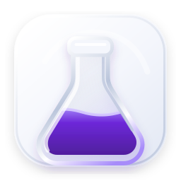
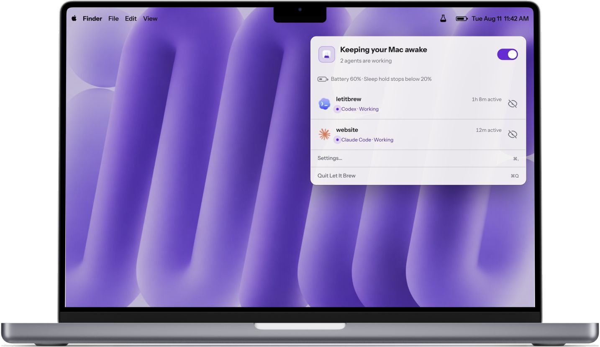

# Let It Brew

**Your Mac sleeps. Your agent dies. Let It Brew fixes that.**

A macOS menu-bar app that keeps your Mac awake while supported local coding
agents work. It lets your Mac sleep as soon as the work stops.

 

Version 1.0.0 (build 45) &middot;
[Release notes and SHA-256](https://github.com/ruban-24/letitbrew/releases/latest) &middot;
[letitbrew.app](https://letitbrew.app)

## What it does

You give an agent a task and walk away. The agent works without touching your
keyboard or trackpad, so macOS can treat you as idle and put the Mac to sleep.
Let It Brew follows signals from the agent about its work.
An awake hold prevents the Mac from sleeping while that work continues.

- **Follows real work.** The hold starts and stops with supported
  local agent activity.
- **Releases when work stops.** Supported questions and approval waits,
  completion, pause, battery limits, and heat limits let the Mac sleep.
  Codex and Cursor approval waits keep the Mac awake.
- **Works with the lid closed.** Active work can continue after you shut the
  MacBook.
- **Saves power with the lid shut.** Closed-lid work runs in Low Power Mode.
  Your exact energy mode returns when the lid opens or work stops.
- **Shows when an agent needs you.** Sessions waiting for an answer or approval
  are marked in the menu. Click any session to bring its terminal, editor, or
  agent app forward.
- **Follows your power rules.** Choose connected-power-only operation, set a
  battery floor, use Low Power Mode, and decide whether displays can sleep.
- **Stays out of the way.** It has no Dock icon, main window, or notifications.
- **Keeps session data local.** There is no account, cloud service, or telemetry.

## Let It Brew vs Caffeine vs Amphetamine

| Feature | **Let It Brew** | Caffeine | Amphetamine |
|---|---|---|---|
| **Best for** | Work from any of the nine supported local agents | A simple manual keep-awake switch | Timers, schedules, and triggers |
| **Understands active agent work** | ✅ Yes, for all nine supported agents | ❌ No | ❌ No |
| **Releases when agent work stops** | ✅ Yes — automatically | ❌ No — manual switch or timer | ❌ No — ends with its session or trigger |
| **Closed lid — with charger** | ✅ Yes | ❌ No | ✅ Yes |
| **Closed lid — without charger** | ✅ Yes | ❌ No | ❌ No |
| **Agent-specific integration** | ✅ Claude Code, Codex, OpenCode, GitHub Copilot CLI, Pi, Cursor, Gemini CLI, Qwen Code, and Kimi Code | ❌ None | ❌ None |

See the [full comparison and guidance](https://letitbrew.app/compare/let-it-brew-vs-caffeine-vs-amphetamine).
If you want a general-purpose keep-awake utility, Caffeine and Amphetamine are
good at that. Let It Brew follows coding-agent sessions.

## Supported agents

| Agent | Local surfaces | Connection |
|---|---|---|
| Claude Code | CLI and local desktop code sessions | Lifecycle hooks after workspace trust |
| Codex | CLI and local app sessions | Lifecycle hooks plus Codex trust approval |
| OpenCode | Stable 1.x local CLI/app runtime | Global OpenCode plugin |
| GitHub Copilot CLI | Local CLI | Copilot user hooks |
| Pi 0.87.1+ | Local CLI | Global Pi extension |
| Cursor | Editor agent and CLI | Cursor user hooks |
| Gemini CLI | Local CLI | Gemini user settings hooks |
| Qwen Code | Local CLI | Qwen user settings hooks |
| Kimi Code | Local CLI | Hooks in Kimi's configuration file |

Version 1.0.0 adds Cursor, Gemini CLI, Qwen Code, and Kimi Code.
To connect an agent, turn on its switch in Settings → Agents.
If you connect Pi, restart Pi or use `/reload` to load the extension.

Hooks are signals that an agent sends about its work.
Let It Brew uses these signals to follow local sessions.
Codex and Cursor do not distinguish manual approval waits from automatic approvals,
so their approval waits keep the Mac awake.
See the [release notes](RELEASE-NOTES.md) for other limits.

Let It Brew follows local sessions only.
Remote, cloud, and SSH sessions are not tracked.
Signals outside the supported hook types are ignored.

Connections are optional. Let It Brew changes no agent configuration until you
turn on an agent's watched switch. Turning it off removes only the entry or
plugin or extension that Let It Brew owns. See the
[agent hook contracts](docs/AGENT-HOOK-CONTRACTS.md) for the exact integration
boundaries.

## Install

A DMG is a disk image that contains the app.
Its SHA-256 is a fingerprint of the downloaded file.

1. [Download the latest signed and notarized DMG](https://github.com/ruban-24/letitbrew/releases/latest/download/LetItBrew.dmg).
2. Make sure that its SHA-256 matches the value on the [latest release](https://github.com/ruban-24/letitbrew/releases/latest).
3. Drag Let It Brew.app into `/Applications`.
4. Launch the app.
5. In Settings → Agents, turn on each agent that you want Let It Brew to follow.

Requires macOS 14 or later. The universal app supports Apple silicon and Intel.
The signed DMG is the only install channel; Let It Brew is not distributed
through Homebrew or the App Store.

Fresh installs begin with every agent disconnected. Launch at Login is off until
you enable it, and Let It Brew observes sessions only while it is running.

Let It Brew must run directly from `/Applications/Let It Brew.app`. A copy in a
subfolder, on the mounted DMG, or in Downloads cannot manage the privileged
closed-lid service.

Codex requires one manual trust step.
Run `/hooks` in Codex.
Trust the Let It Brew entries.
Return to Settings → Agents. The connection refreshes automatically.
If it does not refresh, choose Refresh Connections.
If a session was open when its hooks changed, restart it.

## Safety and privacy

Let It Brew releases its holds when no tracked session is Working.
Supported questions, approval waits, pause, battery limits, and serious or
critical heat also release the hold.
Codex and Cursor approval waits keep the Mac awake.
Approving a Claude, Copilot, Gemini, or Qwen command sends no
signal of its own. After the prompt appears, Let It Brew treats input in that session's app as a possible approval.
It then keeps the Mac awake until the agent reports again.
Typing in other apps does not count, except for sessions under tmux or screen.

Closed-lid support uses a background service with system permissions.
It changes the sleep setting and energy mode, then restores each original value.
Recovery also runs after a crash or restart.
If you decline approval for this service, open-lid operation still works.
See the [architecture document](docs/ARCHITECTURE.md) for the service and its safety rules.

Session content never leaves the Mac. Let It Brew does not record prompts,
responses, reasoning, tool inputs, tool outputs, or final assistant text. See
[Privacy and local data](docs/PRIVACY.md) for the structural metadata and local
paths it uses.

## Updating and uninstalling

Let It Brew checks GitHub for a newer release about 30 seconds after launch, no
more than once per day. It never downloads an update without confirmation. You
can also open **Settings → General → Check for Updates…** at any time. Settings,
agent connections, and session records stay in place.

If you use v0.7.0 or earlier, quit the app and replace it with the new DMG.
Do not uninstall first. See [Support](SUPPORT.md) for the steps.

To remove the app, open **Settings → About → Uninstall Let It Brew…**. Let It
Brew releases its holds, disconnects its agent integrations, unregisters its
background service, removes its local data, and moves itself to the Trash. If
the app will not launch, follow the [manual uninstall procedure](docs/UNINSTALL.md)
in the documented order.

## Documentation

- [Support and troubleshooting](SUPPORT.md)
- [Privacy and local data](docs/PRIVACY.md)
- [Architecture and safety model](docs/ARCHITECTURE.md)
- [Agent hook contracts](docs/AGENT-HOOK-CONTRACTS.md)
- [Release notes](RELEASE-NOTES.md)
- [Contributing](CONTRIBUTING.md)
- [Signing and release process](SIGNING.md)
- [Maintainer UAT](docs/ATTENDED-UAT.md)

## Support the project

Let It Brew is free and open source. If it has been useful, you can support
maintenance, signed releases, new integrations, and more open-source apps
through [GitHub Sponsors](https://github.com/sponsors/ruban-24) or
[Buy Me a Coffee](https://buymeacoffee.com/rubanbhatia).

## Support and contributing

Report reproducible bugs through [GitHub Issues](https://github.com/ruban-24/letitbrew/issues).
Include the Let It Brew version and build, macOS version, Mac model, and clear
reproduction steps. Do not include private project contents, prompts, agent
responses, credentials, or unrelated agent configuration.

Bug fixes and documentation improvements are welcome. Open an issue before
starting feature or release-process work so the scope can be agreed first. See
[CONTRIBUTING.md](CONTRIBUTING.md) for build and test instructions.

## License

Let It Brew v0.6.0 and later is licensed under the
[Apache License 2.0](LICENSE) (`Apache-2.0`). Apache 2.0 permits commercial use and redistribution of the code.
It does not grant rights to present a fork or modified build as the official
Let It Brew project. See
[TRADEMARKS.md](TRADEMARKS.md).

Let It Brew is an independent project. It is not affiliated with or endorsed by
the owners of the supported agents or Apple. Claude, Claude Code, Codex,
OpenCode, GitHub Copilot CLI, Cursor, Gemini CLI, Qwen Code, Kimi Code, and macOS
are trademarks of their respective owners.
